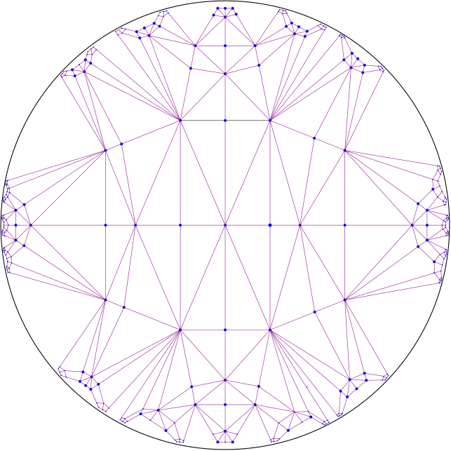

# Luca De Rosa

Mathematician transitioning into machine learning. I did my PhD in Math at ETH Zürich, working on differential geometry and topology.
I am now completing an MSc in Artificial Intelligence at the University of Bologna. I am mostly interested in what geometry can bring to machine learning, generative models and foundational aspects of AI.

## Some Projects

- [**wildfire-risk-italy**](https://github.com/L5900/wildfire-risk-italy): monthly wildfire risk in Italy from NASA satellite data, from raw fire detections to a gridded dataset, simple models and an honest baseline.
- [**jigsaw-transformer**](https://github.com/L5900/jigsaw-transformer): reconstructing images from 9 shuffled, eroded patches with a transformer that predicts the arrangement and inpaints the gaps (Keras, 3.7M parameters).
- [**aircraft-classification-ablation**](https://github.com/L5900/aircraft-classification-ablation): a CNN trained from scratch on 100 aircraft variants, an ablation study of its design choices, and transfer learning with ResNet-18 (PyTorch, group project).
- [**coin-recognition**](https://github.com/L5900/coin-recognition): detecting and recognising euro coins in photos with classical computer vision (OpenCV, group project).
- [**lexilands**](https://github.com/L5900/lexilands): a quiz to learn to recognise European languages from city names, made for Geoguessr players (my CS50P final project; [certificate](CERTIFICATE_LINK)).

<table>
  

  <tr>
    <td align="center" width="50%"><a href="https://github.com/L5900/wildfire-risk-italy"> <b>wildfire-risk-italy</b></a></td>
    <td align="center" width="50%"><a href="https://github.com/L5900/jigsaw-transformer"> <b>jigsaw-transformer</b></a></td>
  </tr>
  <tr>
    <td align="center" width="50%"><a href="https://github.com/L5900/coin-recognition"> <b>coin-recognition</b></a></td>
    <td align="center" width="50%"><a href="https://github.com/L5900/aircraft-classification-ablation"> <b>aircraft-classification-ablation</b></a></td>
  </tr>
  

</table>

## Research

Before moving to AI I worked on geometric topology. Curves on surfaces are sometimes called a *current* and can be **very** complicated. Every current gives rise to a dual space called (surprise) *the dual space of the current*. I spent lots of time studying the class of dual spaces of currents and it turns out they have surprising and somewhat mysterious properties. [Here](https://arxiv.org/abs/2211.05164) is my paper together with Dídac Martínez-Granado, where we develop a theory for dual spaces of currents.

  

In another branch of my research I got interested in non-Archimedean real closed fields, and in [this paper](https://arxiv.org/abs/2212.09640) (joint work with R. Appenzeller, X. Flamm and V. Jaeck) we constructed a space that disproved a conjecture (or rather a common belief) about certain types of R-trees.

[Here](https://www.research-collection.ethz.ch/server/api/core/bitstreams/a1fdbe98-1340-40a5-8ca8-2404f842d06e/content) is my doctoral thesis, written under the supervision of Prof. Marc Burger.

If you have any questions or are curious about my projects and/or research, feel free to write me!

## Contact

[LinkedIn](https://www.linkedin.com/in/luca-de-rosa-b52164264) · [derosaluca.1992@gmail.com](mailto:derosaluca.1992@gmail.com)
